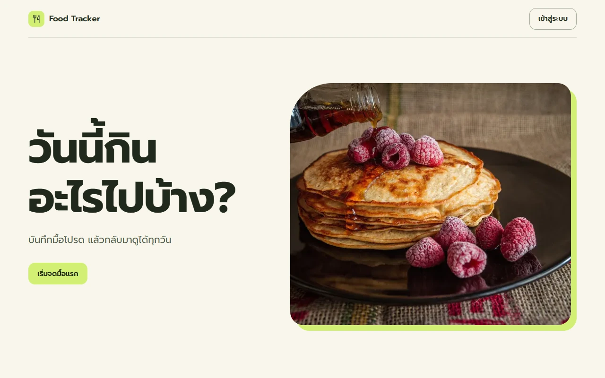
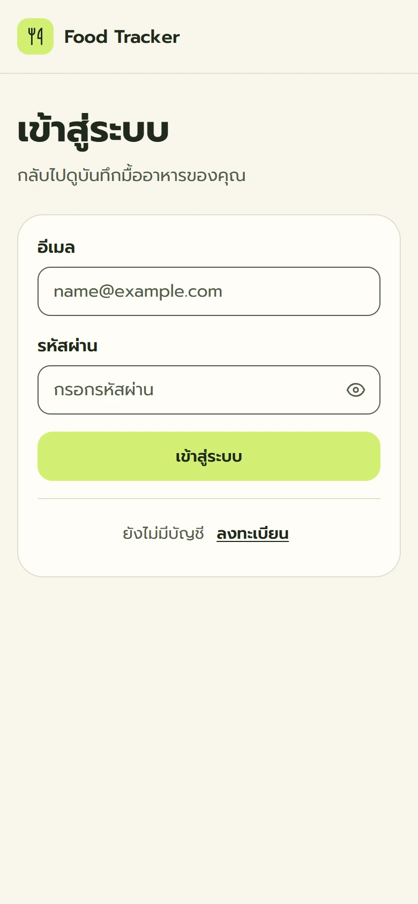
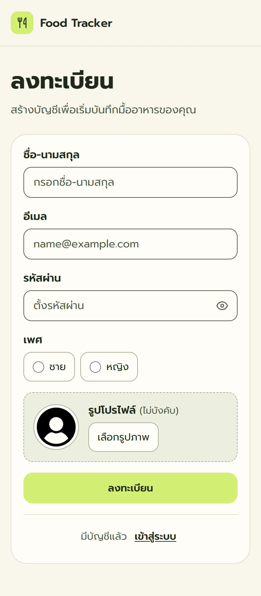
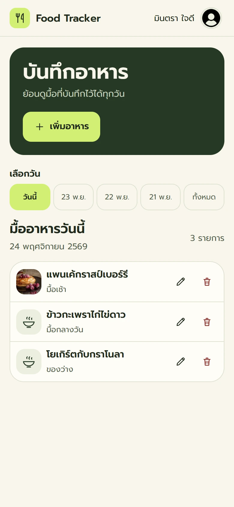
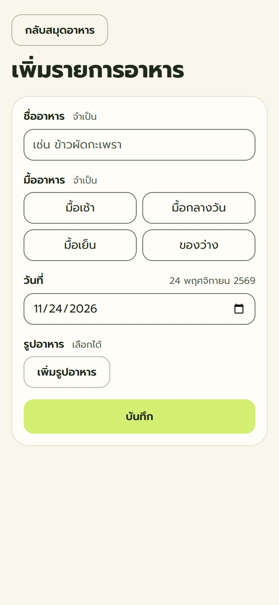
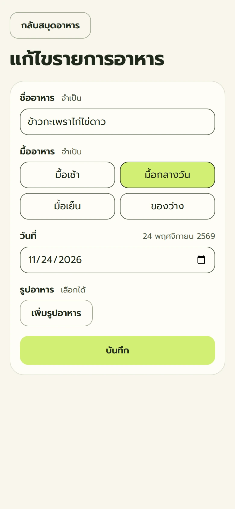
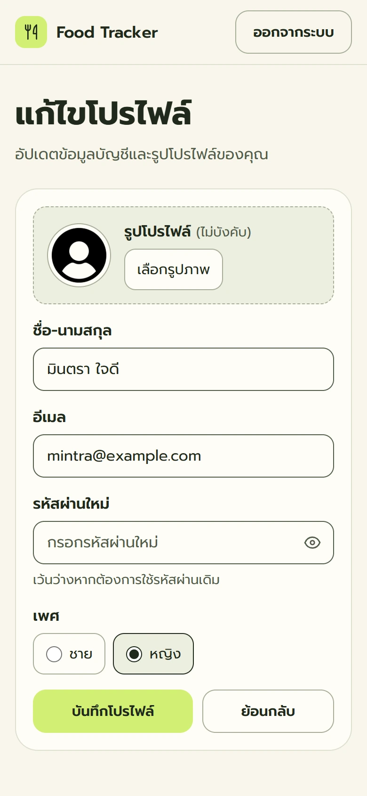

<div align="center">
  


  <br/>
  <br/>
  <h1>🍔 Food Tracker</h1>
  <p><strong>แอปพลิเคชันบันทึกและติดตามการกินอาหาร โดดเด่นด้วยดีไซน์ทันสมัย<br/>พัฒนาด้วย Next.js, React, Tailwind CSS และ Supabase</strong></p>
</div>

<br/>

## ✨ ฟีเจอร์หลัก

- **บันทึกการกินอย่างง่ายดาย:** จดบันทึกและติดตามอาหารที่กินในแต่ละวันได้อย่างสะดวก
- **UI/UX ที่สวยงามและทันสมัย:** ออกแบบด้วย Tailwind CSS รองรับการใช้งานทุกขนาดหน้าจอได้อย่างสวยงาม
- **ทำงานรวดเร็ว:** ขับเคลื่อนด้วย Next.js App Router เพื่อประสิทธิภาพสูงสุดของการโหลดหน้าเว็บ
- **ระบบหลังบ้านที่ปลอดภัย:** จัดการฐานข้อมูลและระบบล็อกอินอย่างมั่นคงด้วย Supabase

## 💻 เทคโนโลยีที่ใช้

- **Framework:** [Next.js v15](https://nextjs.org/)
- **UI Library:** [React v19](https://react.dev/)
- **การตกแต่ง (Styling):** [Tailwind CSS v4](https://tailwindcss.com/)
- **ฐานข้อมูล (Backend/DB):** [Supabase](https://supabase.com/)
- **ภาษาโปรแกรม:** [TypeScript](https://www.typescriptlang.org/)

## 📸 ภาพตัวอย่างแอปพลิเคชัน

ภาพจากเว็บเวอร์ชันปัจจุบัน โดยหน้าโปรไฟล์และบันทึกอาหารใช้ข้อมูลตัวอย่าง

<details>
<summary><b>คลิกเพื่อดูรูปภาพเพิ่มเติม</b></summary>
<br/>

<table align="center">
  <tr>
    <th>เข้าสู่ระบบ</th>
    <th>ลงทะเบียน</th>
  </tr>
  <tr>
    <td></td>
    <td></td>
  </tr>
  <tr>
    <th>บันทึกอาหาร</th>
    <th>เพิ่มรายการอาหาร</th>
  </tr>
  <tr>
    <td></td>
    <td></td>
  </tr>
  <tr>
    <th>แก้ไขรายการอาหาร</th>
    <th>แก้ไขโปรไฟล์</th>
  </tr>
  <tr>
    <td></td>
    <td></td>
  </tr>
</table>

</details>

## 🚀 วิธีติดตั้งและเริ่มต้นใช้งาน

ทำตามขั้นตอนด้านล่างเพื่อรันโปรเจกต์นี้บนเครื่องของคุณ

### สิ่งที่ต้องมีเบื้องต้น (Prerequisites)

- [Node.js](https://nodejs.org/en) (แนะนำให้ใช้เวอร์ชัน 20 ขึ้นไป)
- npm, yarn, pnpm, หรือ bun

### ขั้นตอนการติดตั้ง

1. **โคลน (Clone) โปรเจกต์นี้:**

   ```bash
   git clone https://github.com/your-username/next-food-tracker-app.git
   cd next-food-tracker-app
   ```

2. **ติดตั้ง Dependencies:**

   ```bash
   npm install
   # หรือ yarn install, pnpm install
   ```

3. **ตั้งค่าตัวแปร Environment:**
   สร้างไฟล์ `.env.local` ไว้ที่โฟลเดอร์หลักของโปรเจกต์ และใส่ค่าเชื่อมต่อ Supabase และคีย์ลับสำหรับเซสชันเข้าสู่ระบบ:

   ```env
   NEXT_PUBLIC_SUPABASE_URL=your_supabase_url
   NEXT_PUBLIC_SUPABASE_ANON_KEY=your_supabase_anon_key
   AUTH_SESSION_SECRET=your_random_session_secret
   ```

   สร้างค่า AUTH_SESSION_SECRET ด้วยคำสั่งด้านล่าง แล้วตั้งค่าเดียวกันในทุกอินสแตนซ์ของแอปในสภาพแวดล้อมนั้น

   ```bash
   node -e "console.log(require('node:crypto').randomBytes(32).toString('hex'))"
   ```

4. **รันเซิร์ฟเวอร์แบบนักพัฒนา (Development Server):**

   ```bash
   npm run dev
   # หรือ yarn dev, pnpm dev
   ```

5. **เปิดแอปพลิเคชัน:**
   เปิดเบราว์เซอร์แล้วไปที่ลิงก์ [http://localhost:3000](http://localhost:3000) เพื่อดูผลลัพธ์
